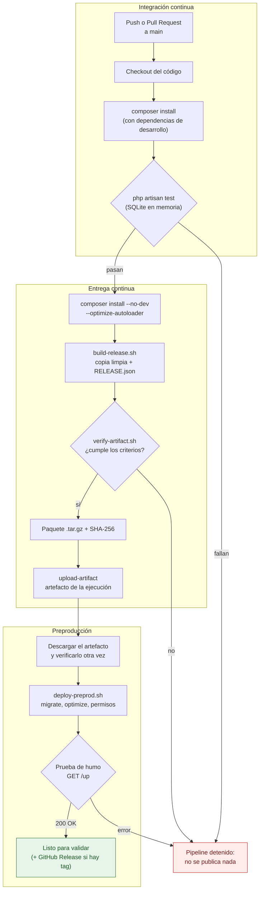

# 1. Diseño del proceso de liberación

**Actividad 12 · Gestión del Proceso de Desarrollo de Software**
Alumno: Sánchez Pérez Emiliano · IDGS · UTVT

Este documento explica cómo pasamos de un commit en GitHub a un paquete de CharBook (la API en Laravel) que se puede instalar en otro ambiente. Todo lo de aquí está implementado en [`.github/workflows/ci-cd.yml`](../../.github/workflows/ci-cd.yml) y en los scripts de [`scripts/release/`](../../scripts/release).

## 1.1 Pasos para preparar una versión liberable

1. **Obtener el código** del commit o del tag que se quiere liberar.
2. **Instalar dependencias con Composer**, esta vez con las de desarrollo, porque se necesitan para probar.
3. **Correr las pruebas** con `php artisan test` (SQLite en memoria, como define `phpunit.xml`). Si algo falla, el pipeline se detiene y no se genera nada.
4. **Reinstalar solo las dependencias de producción** con `composer install --no-dev --optimize-autoloader`. Así el paquete no lleva PHPUnit ni otras herramientas de desarrollo.
5. **Copiar a una carpeta limpia** únicamente lo que la aplicación necesita para correr. Se usa una lista de lo permitido: si una carpeta no está en la lista, no entra al paquete.
6. **Limpiar `storage/` y `bootstrap/cache/`**: se borran logs, sesiones y cachés, pero se conservan las carpetas.
7. **Agregar `RELEASE.json`** con la versión, el commit, la fecha y el autor.
8. **Comprimir** en un `.tar.gz` y calcular su SHA-256.
9. **Verificar el paquete** con `verify-artifact.sh` (criterios de la sección 1.4).
10. **Publicar el artefacto** en la ejecución de GitHub Actions.
11. **Instalarlo en preproducción** y hacer una prueba de humo.

## 1.2 Archivos y dependencias que necesita la aplicación

**Lo que sí va dentro del paquete**

| Elemento | Para qué sirve |
|---|---|
| `app/`, `routes/`, `config/`, `resources/` | El código de la aplicación |
| `bootstrap/` (con `cache/` vacía) | Arranque de Laravel |
| `database/` (migraciones y seeders) | Para crear las tablas en el ambiente nuevo |
| `public/` | Punto de entrada que sirve Nginx |
| `vendor/` | Dependencias de **producción**, ya instaladas |
| `storage/` (solo la estructura, vacía) | Laravel escribe aquí logs, sesiones y archivos |
| `artisan`, `composer.json`, `composer.lock` | Comandos de Laravel y registro exacto de versiones |
| `.env.example` y `.env.preproduccion.example` | Plantillas de variables, sin valores secretos |
| `RELEASE.json` | Identifica qué versión es el paquete |

**Lo que NO va**

| Elemento | Por qué se excluye |
|---|---|
| `.env` y cualquier `.env.*` real | Tienen contraseñas y la `APP_KEY`. Cada ambiente tiene el suyo |
| `.git/`, `.github/` | No hacen falta para ejecutar la app |
| `.agents/`, `.claude/`, notas de trabajo (`HANDOFF.md`, `AGENTS.md`…) | Son del proceso de desarrollo, no de la aplicación |
| `tests/`, `phpunit.xml` | Solo sirven en desarrollo |
| `node_modules/` | No se usa en el servidor |
| `storage/logs/*`, cachés y sesiones | Son datos de otra máquina |
| Llaves (`*.pem`, `*.key`), `auth.json` | Credenciales |

**Lo que debe tener el servidor** (el detalle está en el documento [`02-ambiente-preproduccion.md`](02-ambiente-preproduccion.md)): PHP 8.3 con sus extensiones, un servidor web, PostgreSQL y las variables de entorno propias de ese ambiente. Si se usan Redis, Meilisearch y el bucket de archivos, también deben existir en preproducción.

## 1.3 Estrategia de versiones

Usamos [versionado semántico](https://semver.org/lang/es/): `vMAYOR.MENOR.PARCHE`.

| Versión | Cuándo se usa | Ejemplo en CharBook |
|---|---|---|
| `v1.0.0` | Primera versión estable | La API ya probada en preproducción |
| `v1.0.1` | Solo corrige errores, sin cambiar lo que hace | Arreglar un error en la lista de favoritos |
| `v1.1.0` | Agrega algo nuevo sin romper lo anterior | Agregar el perfil público de lectores |
| `v2.0.0` | Cambia algo de forma que rompe a los clientes | Cambiar la estructura de respuesta de `/api/books` |
| `v1.1.0-rc.1` | Candidata a liberar, se prueba en preproducción | Se marca como *pre-release* en GitHub |
| `v0.0.0-dev.a1b2c3d` | Paquete automático de un push a `main` | Sirve para pruebas internas, no es una versión oficial |

La versión sale del **tag de Git**. Para liberar:

```bash
git tag -a v1.0.0-rc.1 -m "Primera candidata a liberar"
git push origin v1.0.0-rc.1
```

El nombre del paquete queda así: `charbook-api-v1.0.0-rc.1.tar.gz`.

## 1.4 Criterios para generar el artefacto

El paquete solo se publica si **todo** esto se cumple. Si algo falla, el job se detiene en rojo.

| # | Criterio | Quién lo revisa |
|---|---|---|
| 1 | Las pruebas automatizadas pasan | Job `tests` |
| 2 | Las dependencias se instalaron con `--no-dev` a partir de `composer.lock` | Job `build-release` |
| 3 | Están todos los archivos necesarios (`artisan`, `vendor/autoload.php`, `public/index.php`, migraciones…) | `verify-artifact.sh` |
| 4 | No hay `.env`, llaves, credenciales ni logs | `verify-artifact.sh` |
| 5 | No hay PHPUnit, Mockery ni la carpeta `tests/` | `verify-artifact.sh` |
| 6 | El paquete tiene versión (`RELEASE.json`) y checksum SHA-256 | `build-release.sh` |
| 7 | Al instalarlo en limpio, migra la base y responde `200` en `/up` | Job `validate-preprod` |

## 1.5 Diagrama del flujo: de integración continua a preproducción



**Dónde se ve cada etapa en GitHub:** pestaña **Actions** → la ejecución → los cinco jobs numerados. El paquete aparece al final de la ejecución en **Artifacts**, y las versiones con tag también en **Releases**.
